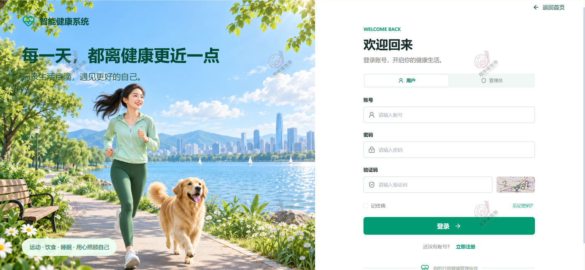
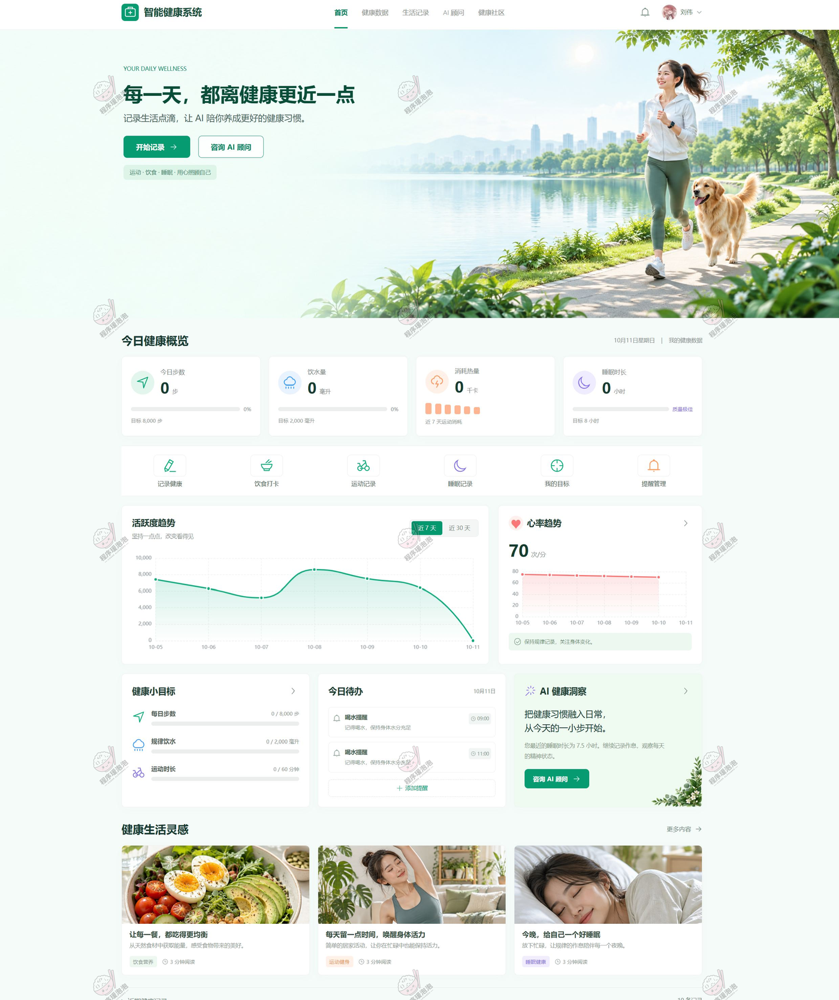
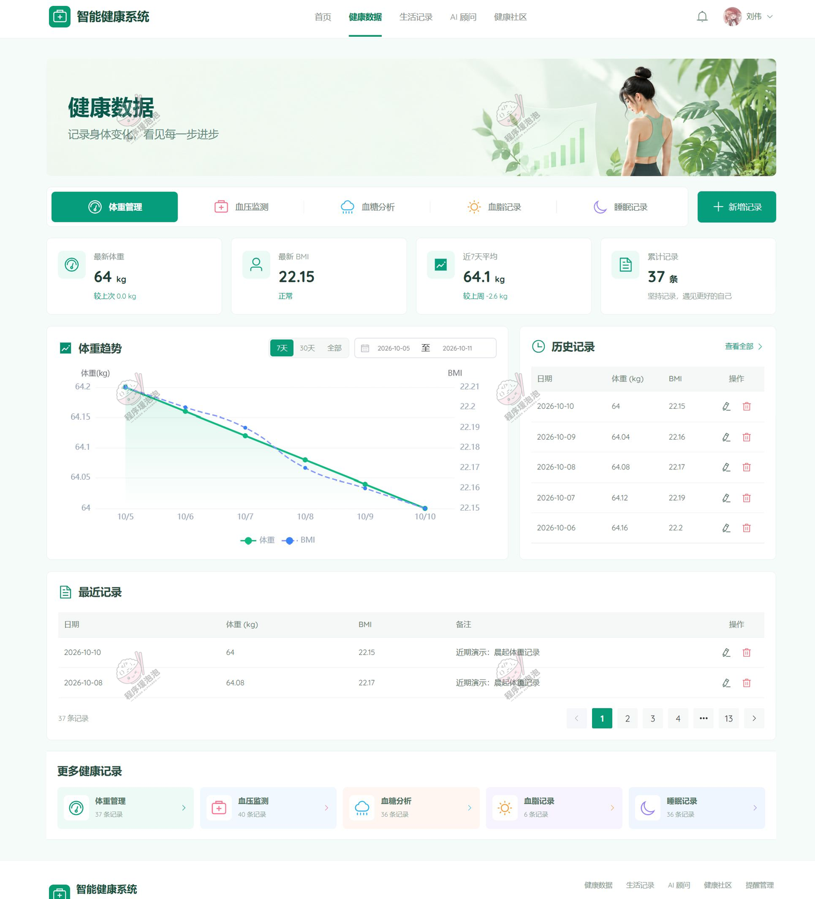
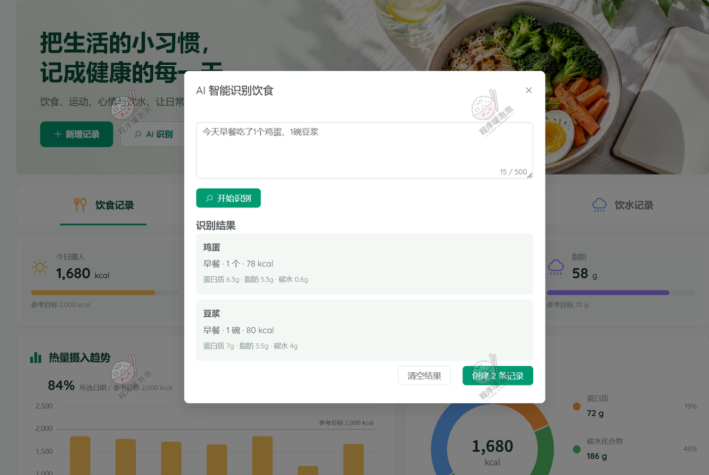
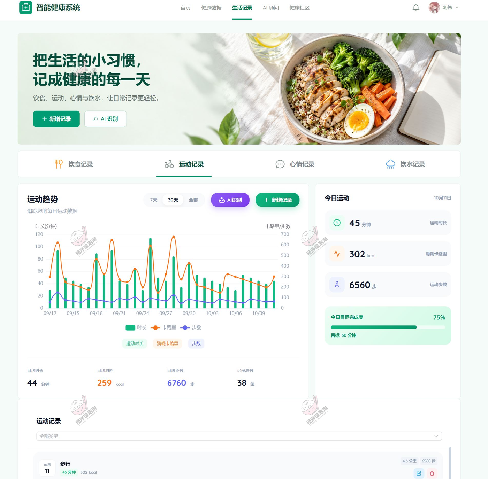
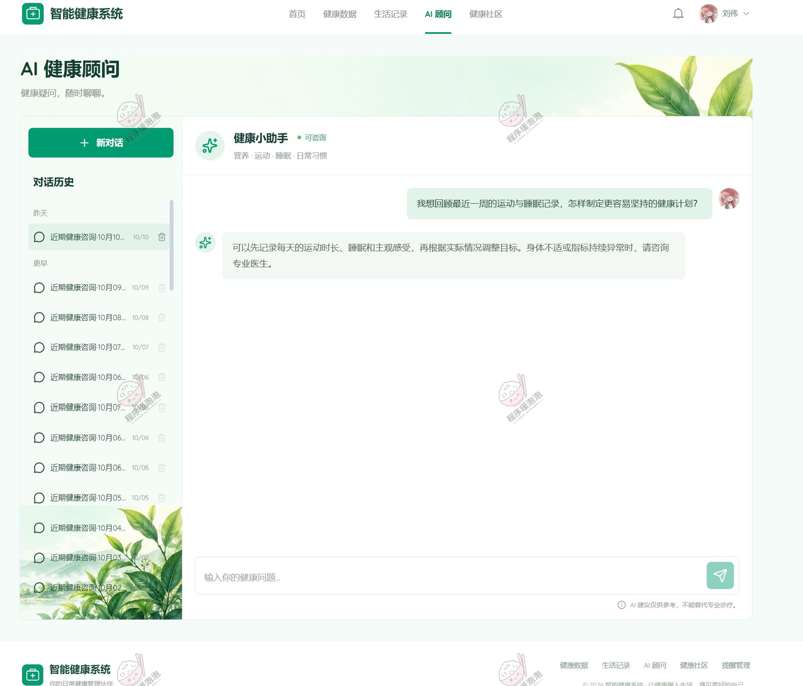
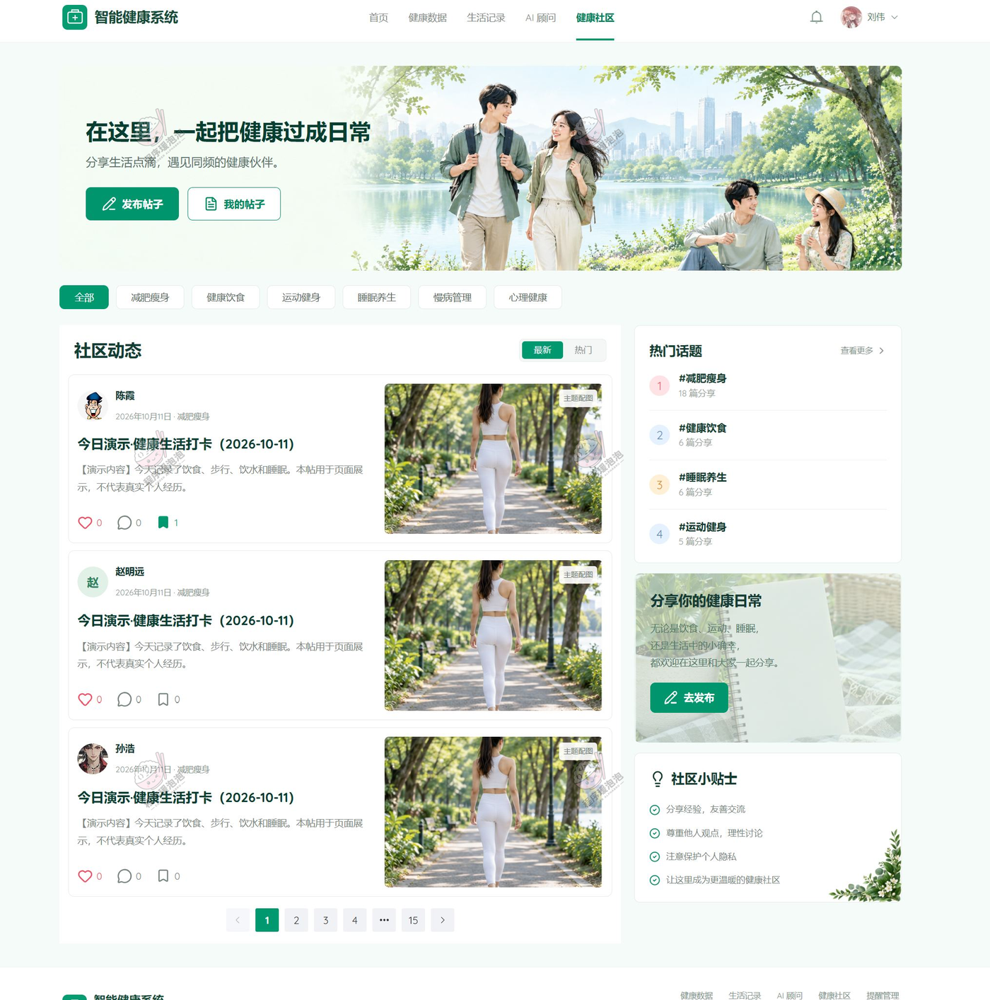
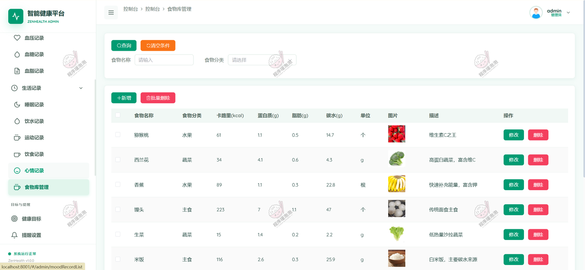
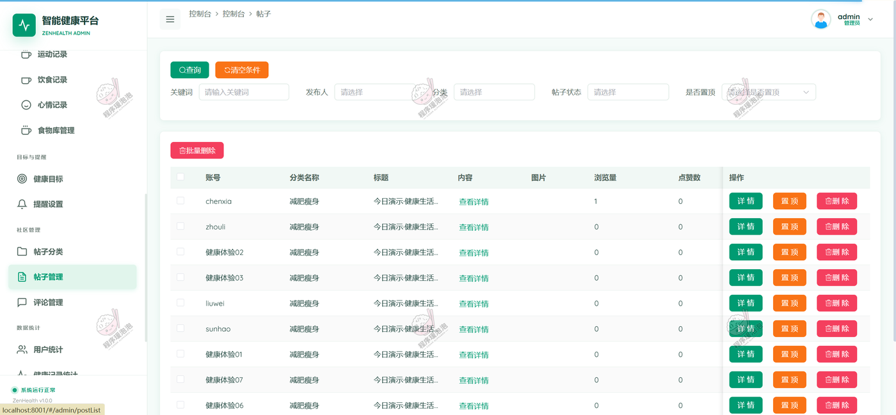
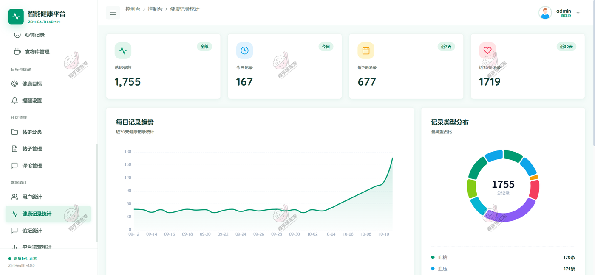

# AiHealthManagement
智能健康平台
亮点：AI健康咨询、AI辅助录入、协同过滤个性化推荐、 ECharts数据分析、健康分享与后台治理、健康管理闭环；
角色：用户、管理员；
数据库：21张；

所有源码均本人开发，项目是前后端分离的，所有的项目都具备了完整的业务逻辑，不仅仅局限于基础的增删改查（CRUD）操作，系统亮点众多。

本文注重于计算机毕业设计选题指导，列出题目均有源码， 大家可以去【公众号】(毕业终点站)获取或者加我【qq】(2112698948)提意见(别忘记Star哟)。备注：git

声明：仅用于学习使用，请勿用于任何商业行为！

1.系统非商用，非开源，非无偿。

2.由本人开发，如需源码，请联系以下方式，qq:2112698948。

3.项目有很多，并未全部上传，如果未找到想要的，可直接咨询。

# 智能健康平台

> 基于 Spring Boot 3 + Vue 3 + DeepSeek 的健康管理平台，普通用户网页端 + 管理后台双角色。
> 接入 AI 健康咨询与辅助录入，用 ECharts 呈现健康趋势与平台运营数据，把日常记录、目标跟踪和社区交流放到同一平台。

## 一、项目简介

这是一套围绕日常健康管理做的应用。普通用户在网页端记录体重、血压、血糖、血脂等健康指标，以及睡眠、饮水、运动、饮食、心情等生活习惯，配合健康目标与提醒形成长期跟踪；管理员在后台维护基础数据、审核社区内容、查看统计分析。

系统里几个花心思的地方：

- **AI 健康咨询**：通过 LangChain4j 接入 DeepSeek，用 SSE 逐步返回回答，多轮会话会保存下来，用户可以接着问、也能回看历史交流。
- **AI 辅助录入**：把饮食和运动的自然语言描述转成结构化记录，用户确认后再保存，省去逐项填写的麻烦。
- **ECharts 数据分析**：从实际业务记录统计健康趋势、活跃用户和论坛互动，支持近 7 天、近 30 天和全部记录查看，图表数据独立于列表分页加载。
- **健康分享与后台治理**：用户发布经验并通过评论、点赞、收藏交流；管理员配合分类维护、审核和置顶管理社区内容。
- **健康记录与目标联动**：九类健康记录与个人目标、提醒及首页进度相互关联，把日常记录、目标跟踪和趋势回顾集中到一处。
- **协同过滤个性化推荐**：饮食推荐用基于用户的协同过滤和余弦相似度找饮食习惯相近的人，帖子推荐用 Jaccard 相似度分析点赞、收藏和评论行为，推荐相似用户互动过但当前用户没看过的内容；数据不足时结合内容相似度、热门帖子或随机食物补充，兼顾个性化与冷启动场景。

## 二、技术栈

| 分层 | 技术 |
|---|---|
| 架构 | B/S、MVC、前后端分离，用户网页端 + 管理后台，管理员与普通用户双角色 |
| 后端 | Java、Spring Boot 3、Spring MVC、MyBatis-Plus、MySQL、JWT、LangChain4j、DeepSeek、SSE 流式响应 |
| 前端 | Vue 3、Vite、Element Plus、Vue Router、Pinia、Axios、ECharts |
| 环境 | Windows / IDEA / JDK 17 / Maven / MySQL / Node.js |

## 三、系统功能

### 3.1 普通用户端
- 账号与个人中心：注册登录、个人资料维护、头像上传、密码修改及退出登录
- 首页健康看板：最新健康指标、目标进度、近期记录及健康趋势
- 健康指标记录：体重与 BMI、血压与心率、血糖、血脂，按日期查询历史变化
- 生活习惯记录：睡眠、饮水、运动、饮食和心情记录，以及对应统计图表
- 健康目标与提醒：饮水、睡眠、饮食、运动、步数和体重目标，提醒时间与重复模式、提醒记录
- 健康论坛：浏览分类帖子、发布健康分享、评论互动、点赞收藏、管理我的帖子与收藏
- AI 健康咨询：新建会话、连续提问、接收流式回复、查看历史消息及删除会话
- AI 辅助录入：用文字描述识别饮食或运动信息，确认后保存为健康记录

### 3.2 管理员端
- 用户管理：用户查询、资料维护、密码重置及手机号、邮箱列表脱敏展示
- 健康记录管理：体重、血压、血糖、血脂、睡眠、饮水、运动、饮食、心情九类记录查询与维护
- 健康管理：健康目标、提醒设置、提醒日志及食物库管理
- 健康论坛管理：帖子分类、帖子审核与置顶、评论、点赞及收藏记录管理
- AI 会话管理：查询和维护咨询会话与消息记录
- 统计分析：用户统计、健康记录统计、论坛统计及平台运营看板

## 四、系统截图

以下选取 10 张代表性截图，按两个角色分别展示。源文档首图为登录入口页，未提供独立的系统总览图。

### 4.1 普通用户端

**登录入口** —— 首页左侧是平台介绍，右侧是登录表单，区分用户与管理员两种身份，支持账号密码加验证码登录与新用户注册。

**首页健康看板** —— 顶部横幅下方是今日健康概览（步数、饮水、燃烧卡路里、睡眠时长），接着活跃趋势与心率趋势折线图、健康小目标、今日待办、AI 健康洞察以及健康生活灵感卡片。

**健康数据** —— 以体重管理为例，展示最新体重、BMI、近 7 天平均值和累计记录数，下方是体重与 BMI 趋势折线图、历史记录表格，支持 7 天 / 30 天 / 全部切换。

**AI 辅助录入** —— 输入"今天早餐吃了 1 个鸡蛋、1 碗豆浆"，AI 智能识别后列出鸡蛋和豆浆的热量与营养成分，确认后可直接创建多条记录，对应把自然语言转成结构化记录的功能。

**生活记录** —— 运动记录页用趋势图展示时长、卡路里和步数，右侧汇总今日运动数据与目标完成度，下方是运动记录列表，顶部同时提供 AI 识别与新增记录入口。

**AI 健康顾问** —— 左侧是会话历史列表，右侧"健康小助手"进行多轮问答，底部输入框可继续提问，会话支持新建、查看与删除，对应接入 DeepSeek 的健康咨询与流式回复。

**健康社区** —— 按减脂瘦身、健康饮食、运动健身、睡眠养生等分类浏览帖子，页面包含社区动态、热门话题、发布入口和社区小贴士，用户可在这里发布分享并互动。

### 4.2 管理员端

**食物库管理** —— 后台按食物名称和分类查询，列表展示食物名称、分类、卡路里、蛋白质、脂肪、碳水、单位、图片和描述，支持新增、修改与删除，为饮食记录提供基础数据。

**帖子管理** —— 按关键词、发布人、分类、状态和是否置顶筛选，列表展示账号、分类、标题、内容、浏览量与点赞数，管理员可查看详情、置顶或删除，对应社区内容审核与治理。

**健康记录统计** —— 用卡片汇总总记录数、今日、近 7 天和近 30 天数据，配合每日记录趋势折线图与记录类型分布环形图，从整体上呈现平台运营情况，对应 ECharts 数据分析。

---

文档展示 10 张截图，需要了解更多，请联系我。
